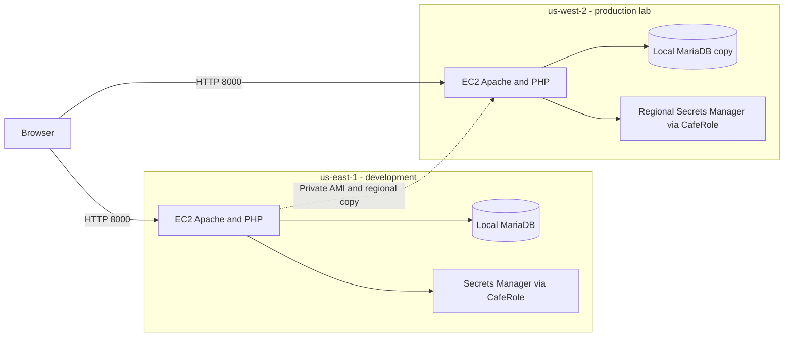

# Architecture

Conceptual diagram of the demonstrated deployment. AMI copying is a one-time image transfer, not live replication. The two applications subsequently stored different orders independently.
