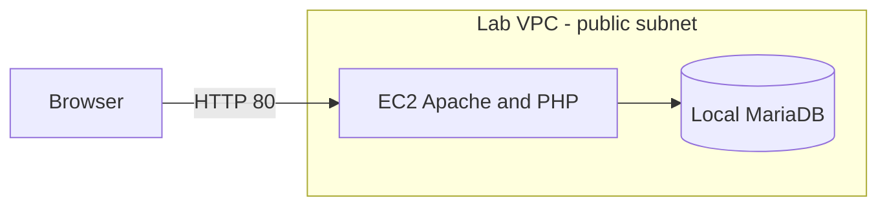
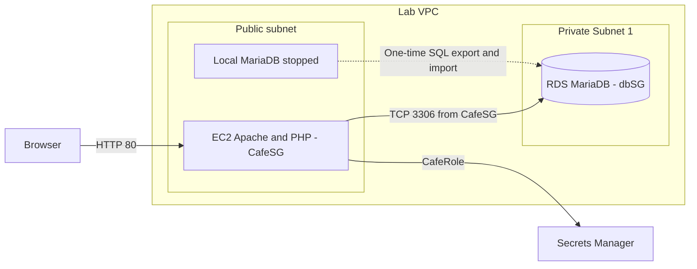

# Database migration architecture

## Before

## After

Secrets Manager is a regional managed service shown outside the VPC boundary. Logical relationships are shown, not all route tables or availability-zone resources.
