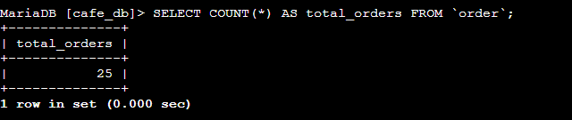
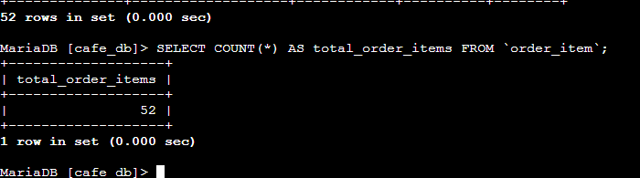
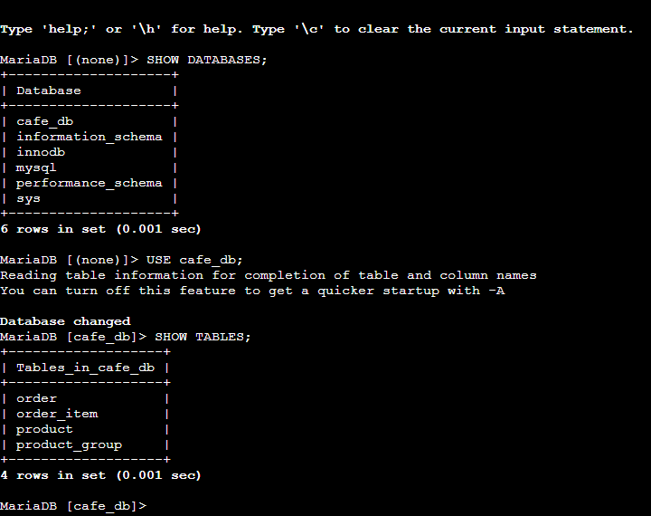
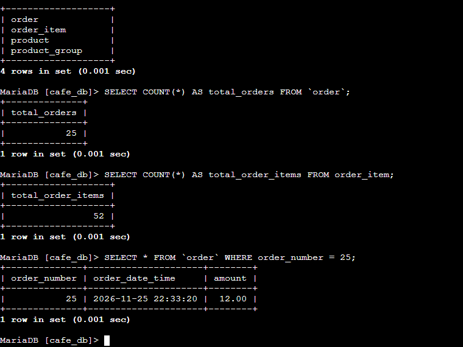
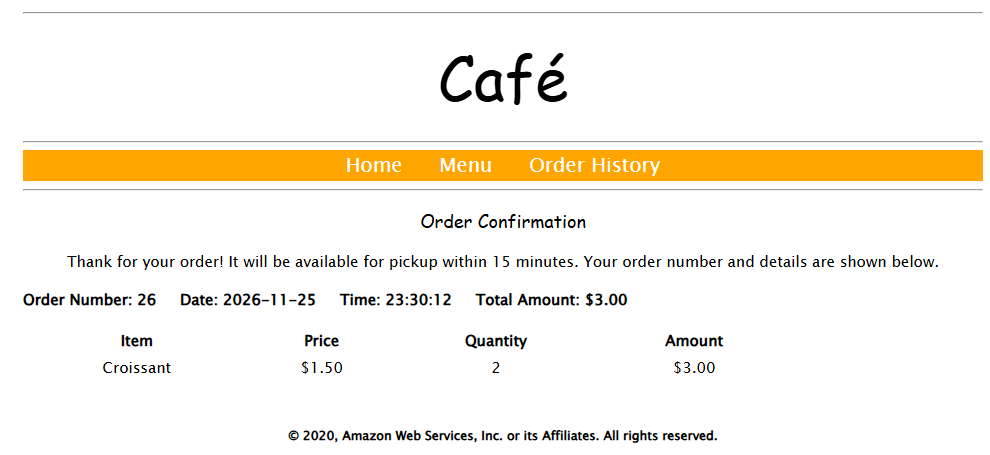
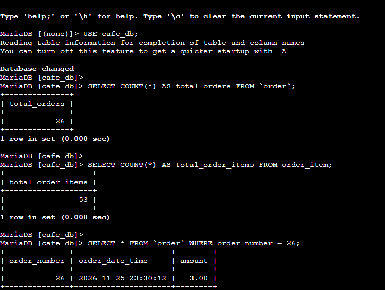
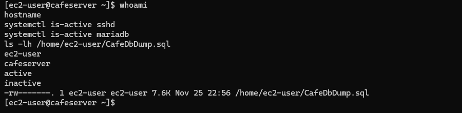

# Selected practical evidence

Cropped original screenshots; browser chrome and unnecessary identifiers omitted. Original evidence is retained separately by the learner.

## Source order count: 25

## Source order-item count: 52

## Imported database and four tables

## RDS baseline counts and pre-migration order

## New application order after shutdown

## Final RDS SQL results: 26 orders and 53 items

## Independent SSH service, database status and dump checks

